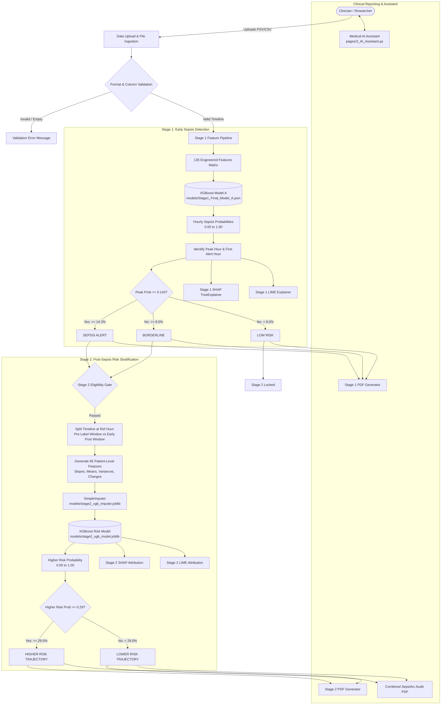
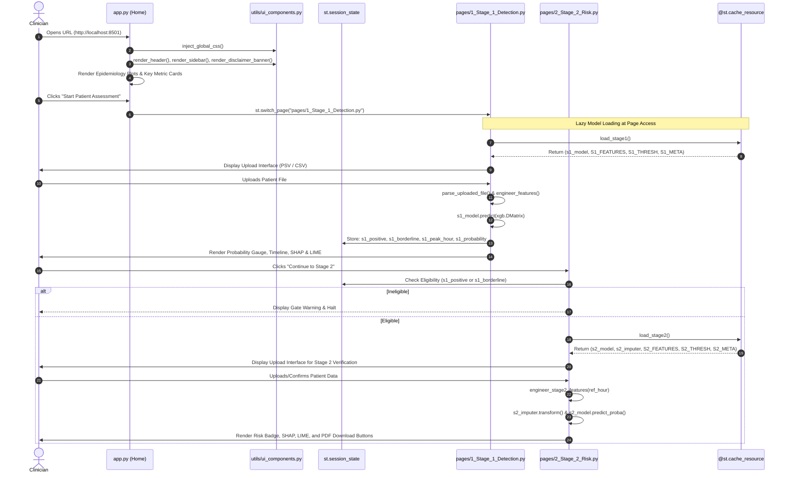
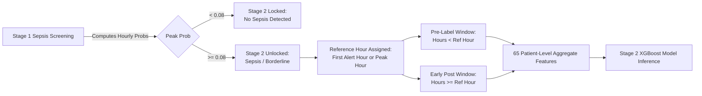
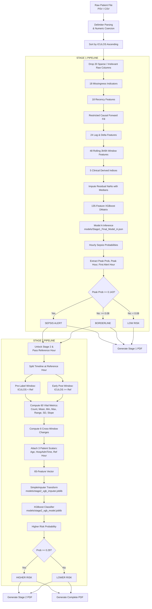
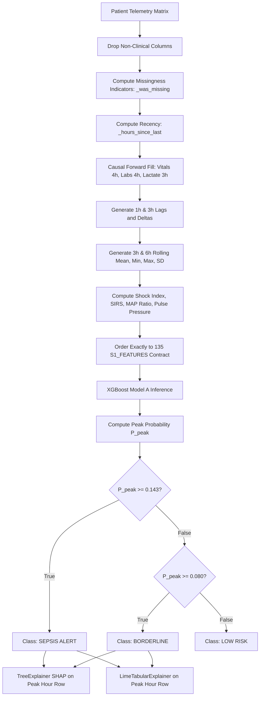
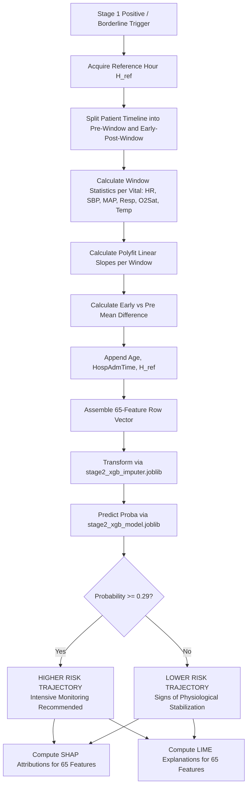
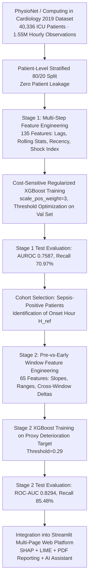

# SepsiArc — Complete Technical & Clinical Application Documentation
**Dual-Stage Explainable Machine Learning Framework for Early Sepsis Detection and Post-Sepsis Risk Stratification**

---

## Document Control & Metadata

| Attribute | Specification |
|---|---|
| **System Name** | SepsiArc (Sepsis Clinical Decision Support Architecture) |
| **Document Version** | 2.4.0 (Production & Technical Reference) |
| **Repository Root** | `c:\Users\manis\OneDrive\Desktop\JAVA program\Sepsis_Mutex` |
| **GitHub Remote** | `https://github.com/MutexTeam/Sepsiarc.git` (Branch: `main`) |
| **Live Web Application** | `https://mutexsepsiarc.streamlit.app` |
| **Primary Framework** | Python 3.10+ / Streamlit 1.60.0 |
| **Primary Dataset** | PhysioNet / Computing in Cardiology (CinC) Challenge 2019 |
| **Classification Paradigm** | Dual-Stage Hierarchical Machine Learning (Hourly Detection + Patient-Level Risk) |
| **Explainability Engines** | SHAP (SHapley Additive exPlanations) & LIME (Local Interpretable Model-agnostic Explanations) |
| **Reporting Engine** | `fpdf2` Pure-Python PDF Generation Architecture (`utils/pdf_report.py`) |
| **Clinical Target Users** | Intensive Care Unit (ICU) Physicians, Critical Care Nurses, Clinical Researchers |
| **Regulatory & Clinical Status** | **Research and Clinical Decision Support Tool Only — Not FDA/CE Approved; Not for Autonomous Clinical Diagnosis** |

---

# 1. Project Overview

### 1.1 Full Project Title & Nomenclature
- **Project Name**: **SepsiArc**
- **Tagline**: *"From Sepsis Detection to Recovery Risk."*
- **Full Formal Title**: *An Explainable Dual-Stage Machine Learning Architecture for Early ICU Sepsis Detection and Subsequent Post-Sepsis Physiological Risk Stratification.*

### 1.2 Clinical Problem Being Addressed
Sepsis is a life-threatening organ dysfunction caused by a dysregulated host response to infection (Sepsis-3 consensus). Globally:
- **48.9 million** sepsis cases occur annually.
- **11.0 million** sepsis-related deaths occur each year, representing **1 in 5 deaths worldwide**.
- **~30%** of all ICU admissions involve sepsis, carrying an ICU mortality rate ranging between 20% and 35%.
- Each hour of delay in antimicrobial and resuscitation therapy during septic shock increases mortality by approximately **7.6%** (Surviving Sepsis Campaign Hour-1 Bundle).

Traditional clinical scoring tools (SIRS, qSOFA, SOFA) have well-documented limitations:
- **SIRS** exhibits high sensitivity but poor specificity, causing alarm fatigue.
- **qSOFA** lacks sensitivity for early detection in intensive care environments.
- **SOFA** requires extensive laboratory panels that often have multi-hour turnaround delays.

Furthermore, traditional ML models function as "single-shot black boxes": once sepsis is flagged, they offer no structured post-event physiological trajectory assessment, and provide no human-interpretable feature attribution to explain *why* an alert fired.

### 1.3 Main Objectives
1. **Early Hourly Detection (Stage 1)**: Screen continuous, irregularly sampled multivariate ICU time-series data at each hourly timestep to identify patients developing sepsis prior to clinical onset (high recall target $\ge 70\%$).
2. **Post-Sepsis Risk Trajectory Stratification (Stage 2)**: For patients flagged positive or borderline in Stage 1, synthesize multi-window physiological dynamics (pre-sepsis vs. early post-sepsis) into a patient-level higher-risk vs. lower-risk stratification.
3. **Dual Explainability (XAI)**: Provide bedside explainability via both **SHAP** (cooperative game theoretic global and local attributions) and **LIME** (local sparse surrogate linear modeling) so clinicians can audit predictions against clinical pathophysiology.
4. **Interactive Clinical Assistant**: Incorporate a guardrailed AI Clinical Assistant grounded in verified project context and evidence-based sepsis guidelines.
5. **Bedside Documentation**: Provide instant, zero-dependency PDF report generation for Stage 1, Stage 2, and complete combined patient trajectory audits.

### 1.4 Target Users & Operational Setting
- **Target Audience**: Intensive care clinicians, hospital rapid response teams, critical care fellows, and biomedical informatics researchers.
- **Operational Setting**: Medical, surgical, and cardiac ICUs requiring non-invasive continuous clinical decision support using standard EHR parameters.

### 1.5 Technology & Methodology Summary
- **App Framework**: Streamlit (Python).
- **Core Algorithms**: Extreme Gradient Boosting (XGBoost), LightGBM, Random Forest, Logistic Regression Stacking.
- **Explainability**: SHAP (TreeExplainer, modern `shap.Explainer`), LIME (`LimeTabularExplainer`).
- **Reporting**: `fpdf2` vector PDF synthesis.
- **LLM Engine**: OpenAI-compatible client routing to OpenRouter / AIMLAPI endpoints.
- **Deployment**: Streamlit Community Cloud linked to GitHub continuous deployment.

---

# 2. Complete Application Architecture

The SepsiArc software system follows a modular, pipeline-driven architecture separating user presentation, ingestion, feature engineering, model inference, explainability engines, and report synthesis.

### High-Level Architecture Data Flow



---

# 3. Repository & Folder Structure

The repository maintains an organized layout decoupling raw data, preprocessed datasets, trained serialized weights, Streamlit multi-page presentation scripts, utility libraries, and visual evaluation assets.

```
c:\Users\manis\OneDrive\Desktop\JAVA program\Sepsis_Mutex\
│
├── .streamlit/
│   ├── config.toml                 # Streamlit server & UI theme configuration
│   ├── secrets.toml                # Local API secrets (AIMLAPI/OpenRouter keys; git-ignored)
│   └── secrets.toml.example        # Template demonstrating required secret variable names
│
├── app.py                          # Application entry point: Home dashboard & clinical epidemiology
├── preprocess.py                   # Full dataset preprocessing & feature engineering pipeline
├── train_models.py                 # Multi-model training, cross-validation & artifact serialization
├── requirements.txt                # Exact Python package dependencies
├── README.md                       # Repository summary, architecture & deployment guide
├── SepsiArc_Complete_Application_Documentation.md # (This document)
│
├── pages/                          # Streamlit Multi-Page Directory
│   ├── 1_Stage_1_Detection.py     # Stage 1: Sepsis screening, hourly timeline, SHAP/LIME, PDF export
│   ├── 2_Stage_2_Risk.py          # Stage 2: Post-sepsis risk stratification, aggregates, SHAP/LIME, PDF
│   ├── 3_AI_Assistant.py          # Conversational educational clinical assistant (LLM API client)
│   ├── 4_Model_Information.py     # Technical model cards, performance metrics & training transparency
│   └── 5_About.py                 # Clinical mission, PhysioNet dataset details & ethical disclaimers
│
├── utils/                          # Shared Python Utility Modules
│   ├── __init__.py                 # Module initialization
│   ├── ui_components.py           # Shared navigation bar, brand styles, footer, metric cards, CSS
│   └── pdf_report.py              # Pure Python vector PDF generator using fpdf2
│
├── models/                         # Serialized Model Artifacts & Metadata
│   ├── Stage1_Final_Model_A.json   # Active Stage 1 XGBoost model weights (native JSON)
│   ├── Stage1_Final_Model_A_Metadata.json # Stage 1 hyperparameters, threshold (0.143), PR-AUC
│   ├── Stage1_FeatureImportance.csv# Feature importances for Stage 1 Model A (135 features)
│   ├── Stage1_Threshold.txt        # Plaintext record of Stage 1 operating threshold (0.143)
│   ├── Stage1_XGBoost.pkl          # Pickle serialization of Stage 1 XGBoost classifier
│   │
│   ├── stage2_xgb_model.joblib     # Active Stage 2 XGBoost model (max_depth=2, 65 features)
│   ├── stage2_xgb_imputer.joblib   # Scikit-learn SimpleImputer fitted on Stage 2 training cohort
│   ├── stage2_xgb_metadata.json    # Stage 2 feature ordering (65 names) & threshold (0.29)
│   ├── stage2_xgb_summary.json     # Test-set evaluation metrics (AUROC 0.8294, Recall 85.48%)
│   │
│   ├── Stage2_Final_Risk50pct_Exports/ # Comprehensive Stage 2 evaluation & validation exports
│   │   ├── Confusion_Matrix.csv    # Test patient classification confusion matrix
│   │   ├── Final_Stage2_Summary.json # Evaluation parameters and limitations
│   │   ├── Final_Test_Results.csv  # Detailed test metrics
│   │   ├── Selected_65_Features.csv# Ranked 65 model features
│   │   ├── Test_Patient_Predictions.csv # Per-patient test probabilities and true labels
│   │   ├── model_metadata.json     # Architecture hyperparameter metadata
│   │   ├── reduced_feature_imputer.joblib # Backup imputer artifact
│   │   ├── reduced_xgboost_model.joblib   # Backup reduced model artifact
│   │   ├── stage2_risk_model_bundle.pkl   # Complete bundled pipeline pickle
│   │   └── Interpretability_65Feature/    # Precomputed SHAP/LIME figures & CSVs
│   │
│   ├── sepsis_best_model.pkl       # Stage 1 LightGBM baseline artifact (from v2 training run)
│   ├── sepsis_xgboost_model.pkl    # Stage 1 XGBoost baseline artifact
│   ├── lgb_explainer_model.pkl     # Serialized LightGBM model for SHAP exploration
│   ├── sepsis_threshold.pkl        # Pickle float of baseline threshold
│   ├── best_model_name.txt         # Text file designating best baseline model
│   ├── feature_names.json          # 79-feature baseline list from preprocess.py
│   ├── model_results.json          # Benchmark comparison metrics across baseline algorithms
│   ├── stage2_model.pkl            # Stage 2 LightGBM hourly severity model
│   ├── stage2_results.json         # Benchmark metrics for hourly LightGBM model
│   └── stage2_threshold.pkl        # Pickle threshold for hourly LightGBM model
│
├── graphs/                         # Generated Benchmark Performance Figures
│   ├── best_model_confusion_matrix.png # Confusion matrix for baseline model
│   ├── calibration_results.png     # Isotonic/sigmoid calibration curves
│   ├── feature_importance.png      # Top 25 feature importances
│   ├── model_comparison.png        # Multi-panel ROC, PR, and F1 curves
│   ├── model_comparison_auroc.png  # Comparative AUROC bar chart
│   └── threshold_analysis.png      # F1, precision, recall vs. threshold curves
│
├── processed_data/                 # Preprocessed Tabular Splits (generated by preprocess.py)
│   ├── train.csv                   # Stage 1 patient-level training split
│   ├── test.csv                    # Stage 1 held-out test split
│   ├── train_stage2.csv            # Stage 2 sepsis-positive training rows
│   └── test_stage2.csv             # Stage 2 sepsis-positive test rows
│
├── notebooks/                      # Development & Prototyping Jupyter Notebooks
│   ├── Sepsis_Project.ipynb        # Exploratory data analysis, feature engineering, experiments
│   └── Train_model.ipynb           # Model development and fine-tuning experiments
│
└── public/                         # Public static branding assets and team media
```

---

# 4. Application Startup Flow

When a user accesses SepsiArc (either locally via `streamlit run app.py` or via Streamlit Community Cloud), the following execution sequence occurs:



### 4.1 Startup Artifacts vs. Runtime Artifacts
- **Startup Artifacts**: Static visual assets, brand stylesheets, and layout tokens are initialized upon opening `app.py`.
- **Runtime Cached Artifacts (`@st.cache_resource`)**:
  - `load_stage1()` in `pages/1_Stage_1_Detection.py`: Loads the 135-feature XGBoost model `Stage1_Final_Model_A.json` (~835 KB) only when the Stage 1 page is visited.
  - `load_stage2()` in `pages/2_Stage_2_Risk.py`: Loads `stage2_xgb_model.joblib` (~458 KB) and `stage2_xgb_imputer.joblib` (~3 KB) only when the Stage 2 page is visited.
  - `@st.cache_data load_all_metadata()` in `pages/4_Model_Information.py`: Loads JSON summaries and feature importance CSVs on demand.

---

# 5. Input Data Specifications

SepsiArc is built specifically to process irregularly sampled clinical time-series files formatted according to the **PhysioNet/Computing in Cardiology Challenge 2019** standard.

### 5.1 Supported Formats
1. **PSV (Pipe-Separated Values)**: Standard PhysioNet format (e.g., `HR|O2Sat|Temp...`).
2. **CSV (Comma-Separated Values)**: Comma-delimited equivalent.
3. **TXT (Plaintext Delimited)**: Text files using pipe or comma delimiters.

*Note: Manual single-row patient entry was explored in early prototypes but is deactivated in the production application because reliable multi-hour lag and rolling window features require a temporal observation timeline.*

### 5.2 File Structure & Column Contracts
The application automatically inspects the first line of the file to determine delimiter type (`|` vs `,`).
- **Row Dimension**: Each row represents **one hourly ICU observation** ($t = 1, 2, 3, \dots, N$).
- **Variable Row Counts Supported**: Fully supported. Patients with as few as 2 hours up to hundreds of hours are accepted. (There is **no fixed row count requirement**).
- **Time Ordering**: The application automatically validates and sorts rows chronologically by `ICULOS` (ICU Length of Stay). If `ICULOS` is absent, the sequential row index is used.

### 5.3 Required & Optional Columns
The file parser strips column whitespace and coerces entries to numeric floats (`pd.to_numeric(errors="coerce")`). Columns may appear in any order.

| Category | Columns Evaluated | Clinical Purpose |
|---|---|---|
| **Vital Signs** | `HR`, `O2Sat`, `Temp`, `SBP`, `MAP`, `DBP`, `Resp` | Cardiovascular and respiratory monitoring; core components of SIRS, qSOFA, and shock index. |
| **Laboratory: Renal & Metabolic** | `Creatinine`, `BUN`, `Glucose`, `Calcium`, `Potassium`, `Magnesium` | Detection of acute kidney injury (AKI), metabolic derangements, electrolyte imbalances. |
| **Laboratory: Hematology** | `WBC`, `Platelets`, `Hgb`, `Hct` | Assessment of infectious response, leukocytosis/leukopenia, sepsis-induced thrombocytopenia. |
| **Laboratory: Perfusion & Blood Gas** | `Lactate`, `pH`, `PaCO2`, `BaseExcess`, `HCO3`, `FiO2` | Identification of cellular hypoxia, tissue hypoperfusion, metabolic acidosis. |
| **Demographics & Context** | `Age`, `Gender`, `HospAdmTime`, `ICULOS` | Baseline physiological risk, pre-ICU hospital stay duration, ICU exposure duration. |
| **Ground Truth (Optional)** | `SepsisLabel` | Ground-truth label (0 or 1). If present in uploaded test files, it is displayed for reference but **never used as a feature during prediction**. |

### 5.4 Data Validation Rules
1. **Empty File Check**: If uploaded file size is 0 bytes or parses to 0 rows, execution halts with an error.
2. **Missing Columns**: Missing columns are created with `NaN` and marked with `_was_missing = 1` indicators.
3. **Extreme Outliers / Non-Numeric Values**: Non-numeric strings (`"error"`, `"null"`, `"N/A"`) are converted to `NaN`. Infinite values (`inf`, `-inf`) are replaced with `np.nan`.

---

# 6. Data Preprocessing Pipeline

Data preprocessing is implemented at two distinct levels:
1. **Offline Training Preprocessing** (`preprocess.py`): Mass-cohort preparation for initial model exploration.
2. **Online Inference Preprocessing** (implemented inside `pages/1_Stage_1_Detection.py` and `pages/2_Stage_2_Risk.py`): Real-time, single-patient feature transformation replicating training conditions without leakage.

### 6.1 Online Preprocessing Operations Step-by-Step

```
Input Patient File (PSV/CSV: N rows × M cols)
        │
        ▼
[Step 1: Delimiter & Numeric Parsing]
  • Detect '|' vs ','
  • Coerce strings to float (errors='coerce')
        │
        ▼
[Step 2: Chronological Ordering & Indexing]
  • Sort strictly by 'ICULOS' ascending
  • Reset index to preserve true temporal progression
        │
        ▼
[Step 3: Drop Sparse / Non-Contract Raw Columns]
  • Drop: Bilirubin_direct, Fibrinogen, TroponinI, Bilirubin_total, Alkalinephos,
          AST, PTT, SaO2, Phosphate, HCO3, Chloride, EtCO2, BaseExcess, PaCO2,
          pH, FiO2, Unit1, Unit2, Maxglucose, Minglucose
        │
        ▼
[Step 4: Explicit Missingness Indicators]
  • For 18 clinical variables: generate '{var}_was_missing' (1 if NaN else 0)
        │
        ▼
[Step 5: Time Since Last Measurement (Recency)]
  • '{var}_hours_since_last' = current_ICULOS - last_valid_observation_ICULOS
        │
        ▼
[Step 6: Causal Forward Fill (Restricted Window)]
  • Vitals (HR, O2Sat, Temp, SBP, MAP, DBP, Resp): ffill(limit=4)
  • Glucose: ffill(limit=4)
  • Slow Labs (Creatinine, WBC, Platelets, BUN, Ca, K, Mg, Hgb, Hct): ffill(limit=4)
  • Perfusion (Lactate): ffill(limit=3)
  • Strictly causal: no backward filling (bfill) during inference to prevent future-data leakage
        │
        ▼
[Step 7: Imputation of Remaining Residual NaNs]
  • Impute residual NaNs using clinical standard medians
  • Replace [inf, -inf] with np.nan then median
        │
        ▼
Output: Standardized Clean Temporal Matrix Ready for Feature Engineering
```

---

# 7. Feature Engineering

Feature engineering is the analytical core of SepsiArc, transforming raw clinical vitals into physiologically expressive temporal representations.

## 7.1 Stage 1 Feature Engineering (135 Features Total)

Stage 1 operates at the **hourly time-step level**, generating a 135-column feature vector for each hour of the patient's stay.

### Breakdown of the 135 Stage 1 Features:
1. **Raw Clinical Baseline Features (18 variables)**:
   - Vitals: `HR`, `O2Sat`, `Temp`, `SBP`, `MAP`, `DBP`, `Resp`
   - Labs: `Glucose`, `Creatinine`, `WBC`, `Platelets`, `BUN`, `Calcium`, `Potassium`, `Magnesium`, `Hgb`, `Hct`, `Lactate`
   - Patient Scalars: `Age`, `Gender`, `HospAdmTime`, `ICULOS`
2. **Missingness Indicators (18 features)**:
   - Formula: `{var}_was_missing = 1 if is_nan else 0`
   - Clinical Rationale: In critical care, the *decision of a clinician to order a test* (e.g., ordering lactate or blood cultures) is itself a potent marker of suspected infection.
3. **Recency Features (18 features)**:
   - Formula: `{var}_hours_since_last = ICULOS - ICULOS_{last_valid}`
   - Clinical Rationale: Older laboratory values become progressively less representative of acute physiological status.
4. **Temporal Lag & Delta Features (24 features)**:
   - For 6 vital signs (`HR`, `O2Sat`, `Temp`, `MAP`, `Resp`, `SBP`):
     - `{var}_lag1` = Value at $t-1$ hour
     - `{var}_lag3` = Value at $t-3$ hours
     - `{var}_change1h` = $\text{Value}_t - \text{Value}_{t-1}$
     - `{var}_change3h` = $\text{Value}_t - \text{Value}_{t-3}$
   - Clinical Rationale: Acute instability manifests as rapid changes rather than single isolated abnormal measurements.
5. **Rolling Window Statistics (48 features)**:
   - For the same 6 vital signs over two rolling horizons ($W = 3$ hours and $W = 6$ hours):
     - `{var}_rolling{W}h_mean`: Moving average
     - `{var}_rolling{W}h_min`: Running nadir
     - `{var}_rolling{W}h_max`: Running peak
     - `{var}_rolling{W}h_std`: Physiological variability (loss of heart rate variability or erratic respiratory rate)
6. **Clinical Derived Indices (5 features)**:
   - **Shock Index**:
     $$\text{Shock\_Index} = \frac{\text{HR}}{\text{SBP}}$$
     *(Values $> 0.9$ indicate occult hypoperfusion / impending circulatory collapse).*
   - **Pulse Pressure**:
     $$\text{Pulse\_Pressure} = \text{SBP} - \text{DBP}$$
     *(Narrowing pulse pressure indicates stroke volume reduction; widening indicates systemic vasodilation).*
   - **MAP Ratio**:
     $$\text{MAP\_Ratio} = \frac{\text{MAP}}{\text{SBP}}$$
   - **Partial SIRS Score**:
     $$\text{SIRS\_partial} = \mathbb{I}(\text{HR} > 90) + \mathbb{I}(\text{Temp} < 36 \lor \text{Temp} > 38) + \mathbb{I}(\text{Resp} > 20)$$
   - **Low MAP Flag**:
     $$\text{Low\_MAP} = \mathbb{I}(\text{MAP} < 65\text{ mmHg})$$
     *(Surviving Sepsis Campaign threshold for vasopressor initiation).*

---

## 7.2 Stage 2 Feature Engineering (65 Features Total)

Unlike Stage 1, Stage 2 operates at the **patient level** (one feature vector per patient). It splits the ICU timeline at the **reference hour** ($H_{\text{ref}}$, the first hour Stage 1 flagged an alert) into two clinical windows:
1. **Pre-Label Window**: All observation hours where $\text{ICULOS} < H_{\text{ref}}$.
2. **Early Post-Label Window**: All observation hours where $\text{ICULOS} \ge H_{\text{ref}}$.

For 6 core vital parameters (`HR`, `SBP`, `MAP`, `Resp`, `O2Sat`, `Temp`), it calculates 10 statistical metrics across each window, plus cross-window trajectory deltas:

| Feature Template | Description & Formula | Rationale |
|---|---|---|
| `{vital}_{Window}_Observed_Count` | Number of non-null observations in the window | Measures monitoring frequency |
| `{vital}_{Window}_Observed_Mean` | Arithmetic mean of observed values | Baseline central tendency |
| `{vital}_{Window}_Observed_Min` | Lowest recorded value in window | Severe hypotensive / hypoxemic drops |
| `{vital}_{Window}_Observed_Max` | Highest recorded value in window | Hypertensive peaks / tachycardia |
| `{vital}_{Window}_Observed_Range` | Peak minus nadir ($\text{Max} - \text{Min}$) | Magnitude of physiological instability |
| `{vital}_{Window}_Observed_SD` | Standard deviation in window | Autonomic and homeostatic dysregulation |
| `{vital}_{Window}_FirstToLast_Change` | $\text{Value}_{\text{last}} - \text{Value}_{\text{first}}$ in window | Directional shift within the window |
| `{vital}_{Window}_Mean` | Arithmetic mean | Summary window average |
| `{vital}_{Window}_Slope` | Linear regression slope: $\beta = \frac{\sum (t - \bar{t})(y - \bar{y})}{\sum (t - \bar{t})^2}$ | Velocity of physiological deterioration/recovery |
| `{vital}_Early_vs_Pre_Change` | $\text{Mean}_{\text{Early}} - \text{Mean}_{\text{Pre}}$ | **Cross-window trajectory**: Determines if patient stabilized or deteriorated following sepsis onset |

Adding the 3 patient-level context scalars:
- `Age`
- `HospAdmTime`
- `ICULOS_at_First_Sepsis_Label` ($H_{\text{ref}}$)

$$6\text{ vitals} \times 10\text{ metrics} + 2\text{ cross-window scalars} + 3\text{ patient scalars} = 65\text{ total features}$$

---

# 8. STAGE 1 — COMPLETE WORKING

## 8.1 Clinical Purpose
Stage 1 provides **early warning of sepsis onset**. It screens multivariate hourly vitals and labs to detect the transition into sepsis hours before formal clinical consensus criteria are met.

## 8.2 Input Specification
- **Format**: PSV/CSV file containing one patient's chronological ICU hourly measurements.
- **Minimum Requirements**: At least 1 valid observation row. Best performance is obtained with consecutive hourly rows.

## 8.3 Preprocessing & Feature Pipeline
- The file is ingested, validated, and transformed through the 10-step `engineer_features()` pipeline into the 135-feature matrix.

## 8.4 Model Specification
- **Exact Model Artifact**: `models/Stage1_Final_Model_A.json`
- **Algorithm**: Extreme Gradient Boosting (XGBoost) Classifier with regularized cost-sensitive learning.
- **Model Parameters**:
  - `max_depth`: 4
  - `learning_rate`: 0.03
  - `n_estimators`: 1,200
  - `subsample`: 0.8
  - `colsample_bytree`: 0.8
  - `min_child_weight`: 5
  - `gamma`: 0.1
  - `reg_alpha`: 0.1 (L1 regularization)
  - `reg_lambda`: 2.0 (L2 regularization)
  - `scale_pos_weight`: 3 (cost-sensitive adjustment for severe class imbalance)
  - `early_stopping_rounds`: 60

## 8.5 Probability Calculation & Decision Threshold
- The model outputs an hourly probability of sepsis:
  $$P(\text{Sepsis}_t) \in [0.0, 1.0]$$
- **Operating Decision Threshold**:
  $$\tau_{\text{Stage 1}} = \mathbf{0.143}$$
  *(Read directly from `models/Stage1_Final_Model_A_Metadata.json`).*

```
Hourly Probability Range:
[0.000 ───────────── 0.080 ────────────────── 0.143 ────────────────────── 1.000]
      LOW RISK                BORDERLINE                  SEPSIS ALERT
 (Stage 2 Locked)       (Stage 2 Accessible)         (Stage 2 Accessible)
```

## 8.6 Temporal Aggregation & Alert Logic
- **Patient-Level Classification**: Determined by the **Peak Probability** across all observed hours:
  $$P_{\text{peak}} = \max_{t} P(\text{Sepsis}_t)$$
- **Peak Hour**: The specific ICU hour ($t$) where $P(\text{Sepsis}_t) = P_{\text{peak}}$.
- **First Alert Hour**: The earliest hour ($t$) where $P(\text{Sepsis}_t) \ge 0.143$. This serves as the clinical early-warning milestone.

## 8.7 Stage 1 Display Outputs
1. **Clinical Status Banner**: High-visibility color-coded card (Red: Sepsis Alert, Amber: Borderline, Green: Low Risk).
2. **Metric Summary Grid**: Peak Probability, Decision Threshold (14.30%), Total Hours Evaluated, First Alert Hour, Peak Hour, Total Alert Hours count.
3. **Interactive Temporal Probability Curve**: Hourly probability plot vs. the 0.143 threshold line, allowing clinicians to inspect onset trajectory.
4. **Hourly Data Table**: Heatmapped table of hourly probabilities, vitals, and flags.
5. **Explainability Visualizations**: Top 10 SHAP feature attribution bar chart and LIME local explanation table for the peak hour.
6. **Download Button**: One-click download of the formal Stage 1 Clinical PDF Report.

---

# 9. STAGE 1 SHAP EXPLAINABILITY

### 9.1 Technical Implementation
- **Explainer Engine**: `shap.TreeExplainer(s1_model)`
- **Target Instance**: Evaluated strictly on the **Peak Risk Hour** feature vector.
- **Feature Attribution**: Computes the exact Shapley value ($\phi_i$) for each of the 135 features:
  $$f(x) = \mathbb{E}[f(X)] + \sum_{i=1}^{M} \phi_i(x)$$
  where $\mathbb{E}[f(X)]$ is the base value (expected model log-odds across the training population) and $\phi_i$ is the marginal contribution of feature $i$.

### 9.2 Interpretation of SHAP Values
- **$\phi_i > 0$ (Red Bars / Positive Contribution)**: The feature pushes the model's prediction *toward* a Sepsis Alert (e.g., elevated heart rate, high shock index, or persistent missingness of blood gases).
- **$\phi_i < 0$ (Blue / Green Bars / Negative Contribution)**: The feature pulls the prediction *down toward* Low Risk (e.g., stable normal blood pressure, normal WBC).
- **Magnitude ($|\phi_i|$)**: Reflects the feature's relative importance in driving the prediction at that specific hour.

> [!IMPORTANT]
> **Clinical Causality Disclaimer**: SHAP values indicate how the machine learning model mathematically weighted each input. They do **not** prove biological causation (e.g., tachycardia may be an associated response rather than the direct causal driver of organ injury).

---

# 10. STAGE 1 LIME EXPLAINABILITY

### 10.1 Technical Implementation
- **Explainer Engine**: `lime.lime_tabular.LimeTabularExplainer`
- **Background Dataset**: Synthetic perturbation matrix generated from column means and standard deviations, bounded by physiological limits ($\ge 0$).
- **Surrogate Model**: Sparse local linear regressor fitted to model predictions in the immediate neighborhood of the patient's peak-hour data point.

### 10.2 Contrast: SHAP vs. LIME in SepsiArc
| Dimension | SHAP (Stage 1) | LIME (Stage 1) |
|---|---|---|
| **Mathematical Basis** | Cooperative Game Theory (Shapley values) | Local Sparse Linear Surrogate Modeling |
| **Model Fidelity** | Exact to tree ensemble structure | Local approximation around the patient vector |
| **Sum Property** | Additive: attributions sum to prediction difference | Approximate local fit |
| **Clinical Presentation** | Shows global rank and directional push | Explains feature threshold rules (e.g., `HR > 105.0`) |

---

# 11. STAGE 1 → STAGE 2 CONNECTION

The linkage between Stage 1 and Stage 2 is the core architectural innovation of SepsiArc. Rather than treating sepsis detection as the terminal output, SepsiArc uses Stage 1 as a **temporal gating trigger** for post-sepsis recovery risk assessment.



### 11.1 Reference Hour Determination
- **Deployment Mode (Active App)**:
  1. The reference hour ($H_{\text{ref}}$) is automatically extracted from `st.session_state["s1_ref_hour"]`.
  2. If the user directly uploads a file in Stage 2 without running Stage 1, $H_{\text{ref}}$ falls back to the earliest hour where `SepsisLabel == 1` (if present in the file), or the median `ICULOS`.
- **Training Mode (`preprocess.py`)**:
  - In training, $H_{\text{ref}}$ was established using the ground-truth `ICULOS_at_First_Sepsis_Label` defined in the PhysioNet challenge protocol.

### 11.2 Handling Edge Cases
- **Stage 1 Negative ($P_{\text{peak}} < 0.08$)**: Stage 2 displays an access restriction warning and stops execution.
- **Insufficient Observations in Windows**:
  - If a patient has 0 hours before $H_{\text{ref}}$ (e.g., septic on admission at Hour 1), `Pre_Observed_Count = 0`, slopes return `0.0`, and stats return `NaN`.
  - The saved `stage2_xgb_imputer.joblib` safely imputes these values using cohort training medians, allowing prediction to proceed without crash.

---

# 12. STAGE 2 — COMPLETE WORKING

## 12.1 Purpose
Patient-level post-sepsis risk stratification. For a patient who has developed sepsis, Stage 2 predicts whether their physiological trajectory points toward **Higher Risk** (protracted organ dysfunction / failure to stabilize) vs. **Lower Risk** (rapid physiological stabilization).

## 12.2 Eligibility Criteria
- Accessible only when Stage 1 yields `SEPSIS ALERT` ($P \ge 0.143$) or `BORDERLINE` ($P \ge 0.080$).

## 12.3 Temporal Windows
- **Pre-Label Window**: Horizon preceding sepsis onset ($\text{ICULOS} < H_{\text{ref}}$).
- **Early Post-Label Window**: Sepsis onset and subsequent hours ($\text{ICULOS} \ge H_{\text{ref}}$).

## 12.4 Feature Matrix & Imputation
- 65 patient-level aggregate features generated by `engineer_stage2_features()`.
- Imputed using `models/stage2_xgb_imputer.joblib` (SimpleImputer fitted on training cohort medians; never refitted during inference).

## 12.5 Model Specification
- **Exact Model Artifact**: `models/stage2_xgb_model.joblib`
- **Algorithm**: Extreme Gradient Boosting (XGBoost) Classifier.
- **Hyperparameters**:
  - `max_depth`: 2 (shallow trees to prevent overfitting on patient aggregates)
  - `n_estimators`: 100
  - `learning_rate`: 0.05
  - `subsample`: 0.8
  - `colsample_bytree`: 0.8
  - `scale_pos_weight`: Balanced for higher-risk proxy prevalence

## 12.6 Probability & Decision Threshold
- The model outputs the probability of higher post-sepsis risk:
  $$P(\text{Higher Risk}) \in [0.0, 1.0]$$
- **Operating Decision Threshold**:
  $$\tau_{\text{Stage 2}} = \mathbf{0.29}$$
  *(Read directly from `models/stage2_xgb_metadata.json`).*

```
Stage 2 Probability Range:
[0.000 ──────────────────────── 0.290 ───────────────────────── 1.000]
         LOWER RISK                         HIGHER RISK
(Physiological Stabilization)          (High Clinical Vigilance Required)
```

## 12.7 Stage 2 Final Output
- **$\ge 0.29$**: **HIGHER RISK** (Red Badge). Indicates worsening organ dysfunction markers, persistent tachycardia, or failure to normalize mean arterial pressure.
- **$< 0.29$**: **LOWER RISK** (Green Badge). Indicates signs of early physiological recovery.

---

# 13. STAGE 2 TARGET / LABEL CONSTRUCTION

To ensure complete scientific and clinical transparency, the definition of the Stage 2 training target must be clearly documented.

### 13.1 Definition of `Risk_50pct`
In the PhysioNet 2019 dataset, long-term post-ICU mortality or formal organ recovery outcomes were not recorded. Therefore, the Stage 2 training label (`Risk_50pct` or `Stage2Label`) was constructed as an **engineered physiological severity proxy**:

```
For sepsis-positive patients, compute severity points across post-label hours:
  • Lactate > 4.0 mmol/L  (Severe hyperlactatemia / cellular hypoxia) ──> +2 Points
  • pH < 7.30             (Severe acidemia)                          ──> +2 Points
  • Creatinine > 2.0 mg/dL (Acute kidney injury)                     ──> +1 Point
  • Platelets < 100 ×10³/µL (Sepsis-induced coagulopathy)             ──> +1 Point
  • MAP < 65 mmHg         (Hypoperfusion / vasopressor need)         ──> +1 Point
  • qSOFA >= 2            (Bedside critical organ failure)           ──> +1 Point

Classification Rule:
  • Total Severity Score >= 3 points  ──> Label 1 (Higher Risk)
  • Total Severity Score < 3 points   ──> Label 0 (Lower Risk)
```

### 13.2 Methodological Transparency Statement
> [!WARNING]
> **Proxy Target Limitation**: `Risk_50pct` is a **rule-derived physiological deterioration proxy**, **not** a clinically adjudicated outcome (such as 30-day all-cause mortality or ventilator-free days). While highly correlated with acute clinical instability, it must be interpreted as a physiological trajectory warning rather than an absolute biological ground truth.

---

# 14. STAGE 2 SHAP EXPLAINABILITY

Stage 2 explainability applies `shap.Explainer` or `shap.TreeExplainer` directly to the 65-feature patient vector.
- **Top Attributions**: Features such as `MAP_Early_vs_Pre_Change`, `HR_Early_Slope`, and `Resp_Early_Observed_Mean` consistently rank highest in determining whether the patient is classified as Higher Risk.
- **Visualization**: Embedded as horizontal bar charts indicating feature contributions toward higher risk (positive) or stabilization (negative).

---

# 15. STAGE 2 LIME EXPLAINABILITY

- **Implementation**: Utilizes `LimeTabularExplainer` fitted against a 200-sample bounded Gaussian perturbation background centered at the patient's feature values.
- **Output**: Generates a tabular feature breakdown showing exact bounding intervals (e.g., `MAP_Early_vs_Pre_Change <= -8.50 mmHg: +0.24 toward Higher Risk`).

---

# 16. COMPLETE MODEL ARTIFACT INVENTORY

| Artifact Path | Stage | Algorithm | Primary Role | Source / Loaded By | Key Parameters / Output |
|---|---|---|---|---|---|
| `models/Stage1_Final_Model_A.json` | 1 | XGBoost | **Active Stage 1 Production Classifier** | `pages/1_Stage_1_Detection.py` | 135 features; threshold `0.143`; outputs hourly sepsis probability |
| `models/Stage1_Final_Model_A_Metadata.json` | 1 | Metadata | Hyperparameter & threshold specifications | `pages/1_Stage_1_Detection.py` | `threshold: 0.143`, `validation_pr_auc: 0.1728` |
| `models/Stage1_FeatureImportance.csv` | 1 | Table | Stage 1 135-feature importance ranks | `pages/4_Model_Information.py` | Gain, cover, and weight per feature |
| `models/Stage1_Threshold.txt` | 1 | Plaintext | Operating decision threshold | Training export | `0.143` |
| `models/Stage1_XGBoost.pkl` | 1 | XGBoost | Serialized pickle of Model A | Backup reference | Equivalent to Model A |
| `models/stage2_xgb_model.joblib` | 2 | XGBoost | **Active Stage 2 Production Classifier** | `pages/2_Stage_2_Risk.py` | 65 features; threshold `0.29`; outputs higher-risk probability |
| `models/stage2_xgb_imputer.joblib` | 2 | SimpleImputer | Imputes residual NaNs in 65 features | `pages/2_Stage_2_Risk.py` | Median strategy fitted on Stage 2 cohort |
| `models/stage2_xgb_metadata.json` | 2 | Metadata | Feature names & decision threshold | `pages/2_Stage_2_Risk.py` | `decision_threshold: 0.29`, 65 feature names |
| `models/stage2_xgb_summary.json` | 2 | JSON Summary | Test-set performance metrics | `pages/2_Stage_2_Risk.py` | `ROC_AUC: 0.8294`, `Recall: 0.8548`, `F1: 0.7211` |
| `models/Stage2_Final_Risk50pct_Exports/*` | 2 | Bundle | Complete audit & evaluation archive | Research Reference | Confusion matrix, test patient predictions, SHAP plots |
| `models/sepsis_best_model.pkl` | 1 | LightGBM | Legacy baseline model | `utils/ui_components.py` | Hourly LightGBM baseline from v2 training run |
| `models/lgb_explainer_model.pkl` | 1 | LightGBM | Legacy explainer model | Research Reference | Saved for SHAP tree benchmarking |
| `models/model_results.json` | 1 | JSON Summary | Comparative multi-model benchmark results | `utils/ui_components.py` | RF, XGBoost, LightGBM, Stacking metrics |
| `models/stage2_model.pkl` | 2 | LightGBM | Legacy hourly severity model | Legacy Benchmark | AUROC `0.9631` on hourly proxy |
| `models/stage2_threshold.pkl` | 2 | Pickle | Legacy Stage 2 threshold | Legacy Benchmark | `0.58` |

---

# 17. MODEL PERFORMANCE METRICS

All reported metrics reflect **held-out test set evaluation** using strict patient-level stratified splitting (no overlapping patients between train and test).

### 17.1 Stage 1 Performance (Sepsis Detection — Model A)
- **Dataset**: PhysioNet/CinC Challenge 2019 (Held-out Test Cohort)
- **Operating Decision Threshold**: **0.143**

| Metric | Test Set Value | Clinical Significance |
|---|---|---|
| **ROC-AUC** | **0.7587** | Discriminative ability across all potential decision thresholds. |
| **Recall (Sensitivity)** | **70.97%** | **Primary clinical metric**: Successfully flags over 7 out of 10 sepsis patients early. |
| **Precision (PPV)** | **11.20%** | Reflects low raw sepsis prevalence in ICU hours (~1.8% to 5.5%); typical for early screening. |
| **F1 Score** | **19.35%** | Harmonic mean of precision and recall under extreme class imbalance. |
| **PR-AUC** | **0.1728** | Precision-Recall AUC (well above the 0.018 random baseline). |

### 17.2 Stage 2 Performance (Post-Sepsis Risk Stratification)
- **Dataset**: Sepsis-positive test cohort ($N = 575$ patients)
- **Operating Decision Threshold**: **0.29**
- **Target Prevalence in Test Set**: 43.13%

| Metric | Test Set Value | Clinical Significance |
|---|---|---|
| **ROC-AUC** | **0.8294** | Strong patient-level discrimination between higher and lower risk trajectories. |
| **PR-AUC** | **0.8001** | High precision-recall area for the higher-risk target class. |
| **Recall (Sensitivity)** | **85.48%** | Captures 85.5% of all patients exhibiting severe deterioration. |
| **Precision (PPV)** | **62.35%** | Nearly two-thirds of all flagged patients represent true high-risk trajectories. |
| **F1 Score** | **0.7211** | High balance between false alarms and missed deterioration. |
| **Overall Accuracy** | **71.48%** | 411 correct classifications out of 575 test patients. |
| **Brier Score** | **0.1659** | Low mean squared error of probability calibration. |

#### Stage 2 Test Confusion Matrix ($N = 575$)
```
                     Predicted Lower Risk    Predicted Higher Risk
Actual Lower Risk            199                      128
Actual Higher Risk            36                      212
```
- **True Positives**: 212 | **False Positives**: 128
- **True Negatives**: 199 | **False Negatives**: 36

---

# 18. AI ASSISTANT

Located in `pages/3_AI_Assistant.py`, the SepsiArc Medical AI Assistant is an interactive conversational intelligence layer.

### 18.1 Technical Architecture
- **Client**: Native `OpenAI` client SDK configured for generic OpenAI-compatible REST endpoints.
- **Provider Auto-Detection**:
  - Keys starting with `sk-or-` route to **OpenRouter** (`https://openrouter.ai/api/v1`).
  - Other keys route to **AIMLAPI** (`https://api.aimlapi.com/v1`).
- **Free-Model Fallback Cascade (OpenRouter)**:
  If the primary configured model returns an empty choice or encounters rate limiting, the engine automatically tries free models in sequence:
  1. `nvidia/nemotron-3-super-120b-a12b:free`
  2. `google/gemma-4-31b-it:free`
  3. `nvidia/nemotron-3.5-lightning:free`
  4. `poolside/laguna-xs-2.1:free`
  5. `apodex/apodex-1.1-mini:free`
  6. `liquid/lfm-2.5-2.6b:free`

### 18.2 Prompt Engineering & Safety Guardrails
The assistant injects two concatenated system prompts on every call:
1. `SYSTEM_PROMPT`: Strictly governs medical ethics, emergency redirection (advising 911/999/112 for acute life threats), prohibits autonomous clinical diagnosis or drug prescribing, and forbids claiming that SHAP implies clinical causality.
2. `SEPSIARC_CONTEXT`: Verified, hardcoded technical facts from the codebase (exact feature counts, models, thresholds, datasets) to prevent hallucination regarding the app's internal workings.

---

# 19. MODEL INFORMATION PAGE

Located in `pages/4_Model_Information.py`, this module serves as an open "Model Card" ensuring complete algorithmic transparency for clinical audit:
- Details the dual-stage division of responsibility (hourly detection vs. patient risk).
- Visualizes the Stage 1 135-feature hierarchy.
- Details the 65 Stage 2 patient-level features.
- Displays full test-set performance metrics, PR-AUC, and ROC curves.
- Documents the strict absence of patient data leakage.

---

# 20. USER INTERFACE FLOW

```
1. Access Home Dashboard (app.py)
   ├── Review global sepsis epidemiology statistics
   └── Click "Start Patient Assessment"
           │
           ▼
2. Stage 1: Detection (pages/1_Stage_1_Detection.py)
   ├── Upload patient timeline (.psv or .csv)
   ├── Review raw patient telemetry preview
   ├── Observe automated feature engineering (135 features)
   ├── Inspect Hourly Probability Curve & Peak Detection
   ├── Review SIRS / Shock Index breakdown
   ├── Inspect Peak-Hour SHAP feature contributions
   ├── Inspect LIME local explanation table
   ├── Download Stage 1 Clinical PDF Report
   └── Click "Continue to Stage 2" (if Alert or Borderline)
           │
           ▼
3. Stage 2: Risk Stratification (pages/2_Stage_2_Risk.py)
   ├── Automated eligibility validation via st.session_state
   ├── Automatic extraction of Stage 1 reference hour
   ├── Extraction of 65 Pre/Early window aggregates
   ├── Automated SimpleImputer transformation
   ├── XGBoost Risk Stratification (Higher Risk vs. Lower Risk)
   ├── Gauge visualization vs. 0.29 threshold
   ├── Inspect Stage 2 SHAP & LIME local attributions
   ├── Download Stage 2 PDF Report
   └── Download Complete Combined Dual-Stage PDF Report
           │
           ▼
4. Optional: Clinical Educational Q&A (pages/3_AI_Assistant.py)
   └── Clarify scoring definitions, SHAP interpretations, or sepsis guidelines
```

---

# 21. OUTPUT FORMATS & DISPLAY MATRIX

| Module | Implemented Outputs | Status |
|---|---|---|
| **Stage 1** | Peak Sepsis Probability (%) | **CURRENTLY IMPLEMENTED** |
| **Stage 1** | Decision Classification (`SEPSIS ALERT`, `BORDERLINE`, `LOW RISK`) | **CURRENTLY IMPLEMENTED** |
| **Stage 1** | First Alert Hour & Peak Risk Hour | **CURRENTLY IMPLEMENTED** |
| **Stage 1** | Continuous Hourly Probability Timeline Chart | **CURRENTLY IMPLEMENTED** |
| **Stage 1** | Top 10 SHAP Feature Contributions Bar Chart | **CURRENTLY IMPLEMENTED** |
| **Stage 1** | LIME Local Explanations Table | **CURRENTLY IMPLEMENTED** |
| **Stage 1** | Downloadable Vector PDF Report | **CURRENTLY IMPLEMENTED** |
| **Stage 2** | Higher Risk Trajectory Probability (%) | **CURRENTLY IMPLEMENTED** |
| **Stage 2** | Risk Category Badge (`HIGHER RISK` vs. `LOWER RISK`) | **CURRENTLY IMPLEMENTED** |
| **Stage 2** | Decision Threshold Comparison Gauge (vs. 29.0%) | **CURRENTLY IMPLEMENTED** |
| **Stage 2** | Vital Sign Pre-vs-Early Mean & Slope Trajectory Table | **CURRENTLY IMPLEMENTED** |
| **Stage 2** | Stage 2 SHAP Attribution Bar Chart | **CURRENTLY IMPLEMENTED** |
| **Stage 2** | Stage 2 LIME Local Explanation Table | **CURRENTLY IMPLEMENTED** |
| **Stage 2** | Downloadable Stage 2 & Combined PDF Reports | **CURRENTLY IMPLEMENTED** |
| **Platform** | Direct EHR HL7 / FHIR Streaming API Ingestion | **PROPOSED / PLANNED** |
| **Platform** | Long-term 30-day Post-Discharge Adjudicated Outcome Prediction | **PROPOSED / PLANNED** |

---

# 22. REPORT GENERATION SYSTEM

Implemented in `utils/pdf_report.py`, SepsiArc features an integrated, production-grade PDF reporting engine built on `fpdf2`.

### 22.1 Architecture & Robustness
- **Pure Python**: Zero reliance on external binary wrappers (such as `wkhtmltopdf` or `weasyprint`), ensuring 100% crash-free execution on Streamlit Community Cloud and Windows.
- **Latin-1 Sanitizer (`_safe()`)**: Core PDF fonts (Helvetica) only support Latin-1 characters. A custom sanitizer automatically maps Unicode arrows (`↑`, `↓`, `→`), comparison symbols (`≥`, `≤`, `±`), dashes (`—`, `–`), and typographical quotes to clean ASCII equivalents.
- **Visual Branding**: Follows SepsiArc design tokens: Navy blue banners, teal subheadings, color-coded risk callouts, structured tabular grids, running page headers, and legal disclaimers.

### 22.2 Available Reports
1. **Stage 1 Sepsis Screening Report** (`build_stage1_pdf`): Patient demographics, peak probability, first alert hour, hourly trajectory summary, top SHAP drivers, clinical review prompts.
2. **Stage 2 Post-Sepsis Risk Report** (`build_stage2_pdf`): Reference hour, pre/early observation window counts, higher risk probability vs. 0.29 threshold, vital trend summary table, SHAP drivers.
3. **Complete Dual-Stage Research & Audit Report** (`build_combined_pdf`): Full end-to-end patient dossier unifying Stage 1 detection, transition metrics, and Stage 2 risk stratification.

---

# 23. COMPLETE DATA FLOW DIAGRAM



---

# 24. STAGE 1 DETAILED FLOWCHART



---

# 25. STAGE 2 DETAILED FLOWCHART



---

# 26. EXPLAINABILITY FLOW

```mermaid
flowchart LR
    subgraph Model Prediction
        Pred[Prediction Generated:\nStage 1: Sepsis Alert\nStage 2: Higher Risk]
    end

    subgraph SHAP Engine
        Pred --> ST[TreeExplainer / Explainer]
        ST --> S_Glob[Global Feature Importance:\nExpected impact across population]
        ST --> S_Loc[Local Attributions phi_i:\nDirectional push (+ / -) for this patient]
    end

    subgraph LIME Engine
        Pred --> LT[LimeTabularExplainer]
        LT --> L_Perturb[Local Bounded Perturbation Sampling]
        LT --> L_Surr[Sparse Linear Surrogate Model Fit]
        LT --> L_Loc[Local Rule Contributions:\ne.g., Shock_Index > 0.95]
    end
```

---

# 27. ERROR HANDLING & SYSTEM RESILIENCE

The software incorporates defensive exception handling across all analytical tiers:
1. **File Parsing Errors**: Malformed lines, non-ASCII binary files, or corrupted headers trigger an explicit UI warning (`st.error("Could not parse file...")`) without unhandled stack traces.
2. **Missing Essential Columns**: If vitals are missing, the pipeline dynamically generates `_was_missing = 1` columns and imputes default values.
3. **Model / Imputer Load Failures**: Encapsulated within `try...except` blocks with `@st.cache_resource`. If weights are missing, a clear administrative alert indicates which file is absent.
4. **SHAP / LIME Execution Failures**: If native TreeExplainer encounters C++ XGBoost compatibility issues, Stage 2 automatically cascades:
   $$\text{Modern shap.Explainer} \longrightarrow \text{Classic TreeExplainer} \longrightarrow \text{Built-in feature\_importances\_ fallback}$$
5. **PDF Generation Encoding Protections**: Wrapped in `_safe()` string sanitation, guaranteeing zero encoding crashes from special Unicode characters.

---

# 28. SECURITY, PRIVACY & COMPLIANCE

### 28.1 API Secret Protection
- LLM API keys (`AIMLAPI_API_KEY`, `AIMLAPI_MODEL`) are managed strictly through Streamlit Secrets (`.streamlit/secrets.toml` or Cloud encrypted environment variables).
- Keys are never logged, printed, or exposed in client-facing HTML or error traces.

### 28.2 Patient Privacy & Data Handling
- **Ephemeral Processing**: SepsiArc does **not** persist uploaded patient telemetry to disk or an external database. Data is processed in volatile server memory for the duration of the Streamlit session and discarded upon session close or browser reload.
- **External API Boundary**: Uploaded numerical time-series matrices (vitals, labs) are **never sent to the LLM API**. The AI Assistant receives only clinical educational text prompts.
- **Regulatory Status**: The application is **not certified under HIPAA, HITECH, or GDPR** as a commercial medical device. It is intended solely for research benchmarking and non-diagnostic evaluation.

---

# 29. DEPLOYMENT ARCHITECTURE

- **Hosting Platform**: Streamlit Community Cloud (Linux container environment).
- **Repository Integration**: Linked directly to `https://github.com/MutexTeam/Sepsiarc.git` on the `main` branch. Automated continuous deployment triggers on every `git push`.
- **Runtime Environment**: Python 3.10+, headless Chromium support for subagent verification.
- **Headless Visualization**: All Matplotlib and Seaborn graphics enforce `matplotlib.use('Agg')` prior to plotting, avoiding X11/GUI display server crashes.

---

# 30. TECHNOLOGY STACK INVENTORY

| Layer | Technology | Version / Specification | Role in SepsiArc |
|---|---|---|---|
| **Frontend / Web UI** | Streamlit | `1.60.0` | Application layout, multi-page routing, state management, file upload |
| **Programming Language** | Python | `3.10+` | Core application and ML logic |
| **Primary Gradient Boosting**| XGBoost | `2.1.4` | Stage 1 Model A (native JSON) & Stage 2 Risk Model |
| **Secondary Gradient Boosting**| LightGBM | `4.7.0` | Benchmark baseline training and legacy explainer |
| **Traditional Machine Learning**| Scikit-Learn | `1.8.0` | SimpleImputer, Random Forest, metrics (ROC, PR, F1) |
| **Imbalanced Learning** | Imbalanced-Learn | `0.14.2` | RandomUnderSampler used during offline training |
| **Explainable AI (Shapley)** | SHAP | `>=0.45.0` | TreeExplainer feature attributions |
| **Explainable AI (Surrogate)**| LIME | `>=0.2.0` | LimeTabularExplainer local rules |
| **Image / Visual Processing** | Scikit-Image | `>=0.21.0` | Transitive dependency supporting LIME visualization |
| **Plotting & Visualization** | Matplotlib / Seaborn | `3.11.1` / `0.13.2` | Probability timelines, epidemiology charts, feature importance |
| **Data Manipulation** | Pandas / NumPy | `3.0.2` / `2.3.5` | Tabular data wrangling, rolling windows, polyfit slopes |
| **Serialization** | Joblib | `1.5.3` | Model and imputer serialization (`.joblib`, `.pkl`) |
| **Reporting Engine** | `fpdf2` | `>=2.7.0` | Pure Python vector PDF clinical report synthesis |
| **LLM Gateway** | OpenAI Python SDK | `>=1.35.0` | REST client connecting to OpenRouter & AIMLAPI endpoints |

---

# 31. RESEARCH METHODOLOGY



---

# 32. KNOWN LIMITATIONS

1. **Class Imbalance in Raw Sepsis**: Raw hourly sepsis prevalence is exceptionally low (~1.8%). While Stage 1 achieves high recall (70.97%), its precision is 11.20%, which in clinical practice would necessitate careful threshold tuning to manage false alarm fatigue.
2. **Proxy Outcome in Stage 2**: As documented in Section 13, Stage 2 predicts `Risk_50pct`, a physiological instability score constructed from ICU vitals/labs, rather than adjudicated 30-day mortality.
3. **Demographic & Geographic Specificity**: The PhysioNet 2019 data originates from two US-based hospital systems (Beth Israel Deaconess Medical Center / Emory Healthcare). Generalizability to community hospitals or global health systems has not been prospectively validated.
4. **Retrospective Evaluation**: The system has been validated on retrospective held-out cohorts. Prospective clinical trials are required prior to bedside diagnostic use.

---

# 33. FUTURE ENHANCEMENTS

### 33.1 Planned / Proposed Architecture
- **EHR Streaming Interoperability (Proposed)**: Direct integration with hospital HL7 FHIR (Fast Healthcare Interoperability Resources) data feeds.
- **Deep Recurrent Baselines (Proposed)**: Benchmarking against temporal architectures (Temporal Convolutional Networks, Mamba, LSTM) to compare against tree-based feature engineering.
- **Prospective Clinical Outcomes (Proposed)**: Retraining Stage 2 against clinically validated outcomes (need for mechanical ventilation, 28-day mortality, ICU readmission) using larger linked MIMIC-IV datasets.

---

# 34. COMPLETE END-TO-END PATIENT WALKTHROUGH

### Example Case: Patient `P001` (65-Year-Old Male)

#### Step 1: Telemetry Ingestion
- Uploaded file: `patient_P001.psv` (24 hourly ICU rows).
- Parameters present: Heart Rate, Blood Pressure, Respiratory Rate, Temperature, Glucose, WBC.

#### Step 2: Stage 1 Screening
- At Hour 1 through Hour 7: Sepsis probability fluctuates between 0.03 and 0.06 (Low Risk).
- At Hour 8: Heart rate accelerates from 84 to 106 bpm, Respiratory Rate increases to 24, SBP drops to 92 mmHg. Shock Index reaches $1.15$.
- **Model Output at Hour 8**: Probability spikes to **0.384** ($\ge 0.143$).
- **First Alert Hour**: **Hour 8**.
- **Peak Hour**: **Hour 12** ($P = 0.642$).
- **Result**: **`SEPSIS ALERT`**.
- **Top SHAP Drivers**: `Shock_Index` (+0.31), `HR_rolling6h_mean` (+0.24), `Low_MAP` (+0.18).

#### Step 3: Transition to Stage 2
- Stage 2 unlocks automatically with Reference Hour set to **Hour 8**.
- **Pre-Label Window**: Hours 1 to 7 ($N = 7$ observations).
- **Early Post-Label Window**: Hours 8 to 24 ($N = 17$ observations).

#### Step 4: Stage 2 Risk Stratification
- Features extracted:
  - `HR_Pre_Observed_Mean`: 81.2 bpm | `HR_Early_Observed_Mean`: 108.5 bpm | `HR_Early_vs_Pre_Change`: +27.3 bpm
  - `MAP_Early_Slope`: -1.42 mmHg/hr (persistent downward drift despite resuscitation)
- Stage 2 XGBoost predicts higher risk probability: **0.582** ($\ge 0.29$).
- **Classification**: **`HIGHER RISK`** (Red Callout).
- **Clinical Recommendation**: High clinical vigilance warranted. Frequent lactate reassessment and evaluation for escalating vasopressor requirement.

#### Step 5: Report Generation
- Clinician clicks **"Download Complete SepsiArc Report (PDF)"**. A 3-page clinical dossier is generated in ~1.2 seconds containing all telemetry, risk predictions, SHAP attribution plots, and legal disclaimers.

---

# 35. VIVA / PRESENTATION SUMMARY

For academic reviews, project vivas, and clinical presentations, the essential architecture of SepsiArc is summarized below:

- **What is SepsiArc?** An explainable, dual-stage machine learning clinical decision-support application designed for ICU sepsis detection and trajectory risk stratification.
- **What does Stage 1 do?** Analyzes hourly multivariate time-series data to provide early detection of sepsis onset using a 135-feature cost-sensitive XGBoost model ($P \ge 0.143$, AUROC 0.7587, Recall 70.97%).
- **What does Stage 2 do?** Stratifies post-sepsis trajectory into Higher Risk vs. Lower Risk using a 65-feature patient-level XGBoost model ($P \ge 0.29$, ROC-AUC 0.8294, Recall 85.48%).
- **Why two stages?** Sepsis management requires two distinct clinical decisions: first, *detecting* infection early to initiate antibiotics; second, *stratifying* patients after onset to allocate intensive care resources and anticipate deterioration.
- **Why SHAP and LIME?** To eliminate "black-box" skepticism. SHAP provides mathematically rigorous global/local Shapley feature attributions, while LIME provides intuitive local threshold rules.
- **How do the stages connect?** Stage 1 serves as an eligibility trigger. When positive, its earliest alert hour defines the reference split point for Stage 2's pre- and post-sepsis window feature extraction.
- **What is the final output?** Dual visual dashboard analytics, interactive probability curves, local XAI charts, and zero-dependency downloadable PDF clinical reports.
- **What are the key limitations?** Retrospective dataset origin (PhysioNet 2019), proxy target formulation for Stage 2 severity, and non-diagnostic research status.

---

# 36. FINAL SYSTEM SUMMARY

```
┌──────────────────────────────────────────────────────────────────────────────────┐
│                             SEPSIARC SYSTEM SUMMARY                              │
├──────────────────────────────────────────────────────────────────────────────────┤
│                                                                                  │
│   [ INPUT ] ──► Hourly ICU Telemetry (PSV / CSV, Variable Length)                │
│       │                                                                          │
│       ▼                                                                          │
│   [ PREPROCESS ] ──► Chronological Sort, Causal FFill (3-4h), Recency & Missing  │
│       │                                                                          │
│       ▼                                                                          │
│   [ STAGE 1 ] ──► 135 Engineered Features ──► XGBoost Model A                    │
│       │           Threshold: 0.143  |  AUROC: 0.7587  |  Recall: 70.97%          │
│       │           Output: SEPSIS ALERT / BORDERLINE / LOW RISK                   │
│       │                                                                          │
│       ▼                                                                          │
│   [ EXPLAINABILITY 1 ] ──► TreeExplainer SHAP & LIME on Peak Risk Hour           │
│       │                                                                          │
│       ▼                                                                          │
│   [ TRANSITION ] ──► Eligibility Gate & Reference Hour (H_ref) Split             │
│       │                                                                          │
│       ▼                                                                          │
│   [ STAGE 2 ] ──► 65 Patient-Level Features (Pre vs Early Windows)               │
│       │           SimpleImputer ──► XGBoost (max_depth=2)                        │
│       │           Threshold: 0.29   |  ROC-AUC: 0.8294  |  Recall: 85.48%        │
│       │           Output: HIGHER RISK / LOWER RISK                               │
│       │                                                                          │
│       ▼                                                                          │
│   [ EXPLAINABILITY 2 ] ──► Patient-Level SHAP & LIME Trajectory Drivers          │
│       │                                                                          │
│       ▼                                                                          │
│   [ REPORTING ] ──► Vector PDF Dossiers (fpdf2) & Medical AI Assistant           │
│       │                                                                          │
│       ▼                                                                          │
│   [ DEPLOYMENT ] ──► Streamlit Community Cloud (https://mutexsepsiarc.streamlit.app) │
│                                                                                  │
└──────────────────────────────────────────────────────────────────────────────────┘
```

---
*End of Documentation — SepsiArc Architecture & Technical Manual.*
