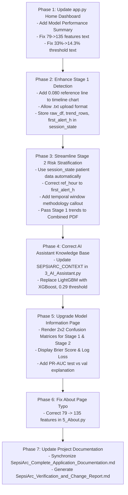

# SepsiArc — Comprehensive Verification, Reconciliation & Implementation Plan
**Document Version:** 1.0.0  
**Date:** October 28, 2026  
**Status:** DRAFT & AUDIT COMPLETE — AWAITING USER COMMAND BEFORE IMPLEMENTATION  
**Primary References:**
1. `Wesbite_Output_Flow.pdf` (22 pages) — Comprehensive Website Output & Flow Design
2. `Website Flow.pdf` (10 pages) — Website Design and Execution Strategy
3. `SepsiArc_Complete_Application_Documentation.md` — Current Technical & Clinical Application Documentation
4. Current Active Codebase (`app.py`, `pages/1..5`, `utils/`, `models/`)

---

## Executive Summary

A comprehensive, line-by-line audit was conducted comparing the **two new requirement documents** (`Wesbite_Output_Flow.pdf` and `Website Flow.pdf`) against the **active codebase**, **model artifacts**, **evaluation outputs**, and **existing documentation**.

The core architecture of SepsiArc is fundamentally sound and matches the proposed vision:
- **Stage 1** runs the active 135-feature Regularized Cost-Sensitive XGBoost model (`Stage1_Final_Model_A.json`) at threshold `0.143`.
- **Stage 2** runs the active 65-feature patient-level XGBoost model (`stage2_xgb_model.joblib`) with `stage2_xgb_imputer.joblib` at threshold `0.29` predicting the `Risk_50pct` physiological-risk proxy.
- **Explainability** provides local explanations via both SHAP (`shap.TreeExplainer` / `shap.Explainer`) and LIME (`LimeTabularExplainer`).
- **Reporting** generates downloadable Stage 1, Stage 2, and Combined PDF reports via `fpdf2`.
- **AI Assistant** is an OpenAI-compatible conversational agent with medical safety guardrails.

However, several **critical gaps, legacy leftovers, and presentation inconsistencies** were identified across `app.py`, `pages/1_Stage_1_Detection.py`, `pages/2_Stage_2_Risk.py`, `pages/3_AI_Assistant.py`, `pages/4_Model_Information.py`, and `pages/5_About.py`.

This document provides:
1. **The Complete Requirement-by-Requirement Extraction** from both PDFs.
2. **The Full Discrepancy & Reconciliation Matrix** comparing the requirements against actual code.
3. **Model & Metric Provenance Resolution** (resolving 135 vs 79 features, 0.1605 vs 0.1728 PR-AUC, confusion matrices, etc.).
4. **The Phased, Safe Implementation Plan** detailing the exact file modifications and functions required.
5. **The Comprehensive Regression Test Protocol**.

> [!IMPORTANT]
> **NO APPLICATION CODE HAS BEEN MODIFIED YET.**  
> In strict compliance with instructions, this plan has been created and verified first. All modifications await explicit user command.

---

# SECTION 1: Master Requirement Extraction from New PDFs

### Document 1: `Wesbite_Output_Flow.pdf` (22 Pages)
| Ref ID | PDF Section | Requirement Description | Target Component |
|---|---|---|---|
| **REQ-WOF-01** | § 1, 2.1 A-D | Prominently display project name, objectives (5 items), overview of Stage 1 (hourly XGBoost) and Stage 2 (patient-level XGBoost `Risk_50pct` proxy), and research disclaimer. | `app.py` |
| **REQ-WOF-02** | § 2.1 E | Display **Model Performance Summary** on Home Dashboard for both stages: Stage 1 (Acc 68.05%, Prec 11.20%, Rec 70.97%, F1 19.35%, ROC-AUC 0.7587, PR-AUC 0.1605); Stage 2 (Acc 71.48%, Prec 62.35%, Rec 85.48%, F1 72.11%, ROC-AUC 0.8294, PR-AUC 0.8001). Label as experimental. | `app.py` |
| **REQ-WOF-03** | § 2.1 F | Prominent "Start Patient Assessment" button redirecting to Stage 1. | `app.py` |
| **REQ-WOF-04** | § 3.1 | Stage 1 file upload supporting PSV, CSV, TXT with automatic delimiter detection and validation. | `pages/1_Stage_1_Detection.py` |
| **REQ-WOF-05** | § 3.2, 9.1 | Uploaded data preview with row counts, columns, missing value summary, and data quality check. | `pages/1_Stage_1_Detection.py` |
| **REQ-WOF-06** | § 3.3, 9.2 | Display processing status feedback ("Data validation completed", "Preprocessing completed", "Temporal features generated", "Stage 1 prediction completed"). | `pages/1_Stage_1_Detection.py` |
| **REQ-WOF-07** | § 3.4 A-E | Stage 1 Prediction Summary: Peak Sepsis Probability, Hour of Peak Probability, First Alert Hour (or "No Sepsis Alert threshold crossing detected"), Overall Alert Category (Low <0.080, Borderline 0.080–0.143, Sepsis Alert ≥0.143), Processed Observations count. | `pages/1_Stage_1_Detection.py` |
| **REQ-WOF-08** | § 3.5, 9.4 | Hourly Probability Timeline chart showing: predicted probability per hour, **TWO horizontal reference lines** (at 0.080 and 0.143), and category boundary annotations. | `pages/1_Stage_1_Detection.py` |
| **REQ-WOF-09** | § 3.6 | Hourly Prediction Table with observation hour, probability, assigned category, agreeing with the chart. | `pages/1_Stage_1_Detection.py` |
| **REQ-WOF-10** | § 3.7 | Stage 1 SHAP explanation for the peak-risk hour (top 10 features, TreeExplainer, disclaimer). | `pages/1_Stage_1_Detection.py` |
| **REQ-WOF-11** | § 3.8 | Stage 1 LIME explanation for the peak-risk hour (table/chart, direction, weight). | `pages/1_Stage_1_Detection.py` |
| **REQ-WOF-12** | § 3.9, Step 6 | Stage 2 Eligibility check: If eligible (peak ≥ 0.080), show navigation button; if ineligible, explain why. | `pages/1_Stage_1_Detection.py` |
| **REQ-WOF-13** | § 4.1, 4.2 | Stage 2 Eligibility & Temporal Window display: Reference hour (Hour 0), Pre-label window (-12 to -1), Early post-label window (+1 to +3), observation counts, target window (+4 onward) note. | `pages/2_Stage_2_Risk.py` |
| **REQ-WOF-14** | § 4.3 | Generate 65 patient-level aggregate features using pre-fitted SimpleImputer and XGBoost model. | `pages/2_Stage_2_Risk.py` |
| **REQ-WOF-15** | § 4.4 | Stage 2 Prediction Summary: Higher-Risk Probability, Decision Threshold (0.29), Classification (Higher Risk vs Lower Risk), non-diagnostic disclaimer. | `pages/2_Stage_2_Risk.py` |
| **REQ-WOF-16** | § 4.5 | Physiological Trend Summary: HR, Resp, Temp, MAP across pre-label vs early post-label windows (mean, change, trend). | `pages/2_Stage_2_Risk.py` |
| **REQ-WOF-17** | § 4.6, 4.7 | Stage 2 SHAP and LIME explanations for the patient-level prediction. | `pages/2_Stage_2_Risk.py` |
| **REQ-WOF-18** | § 4.8 | Stage 2 Result Summary card synthesizing eligibility, ref hour, probability, threshold, category, warnings. | `pages/2_Stage_2_Risk.py` |
| **REQ-WOF-19** | § 5.1, 5.2 | AI Assistant answering questions on differences between Stage 1 & 2, recall, threshold 0.143, threshold 0.29, SHAP, LIME, limitations. | `pages/3_AI_Assistant.py` |
| **REQ-WOF-20** | § 6.1, 6.2 | Model Information page with technical specifications for Stage 1 (135 feats, 0.143 thresh) and Stage 2 (65 feats, 0.29 thresh, `Risk_50pct` target). | `pages/4_Model_Information.py` |
| **REQ-WOF-21** | § 6.3, 9.7 | Display **Confusion Matrices** for both stages: Stage 1 (TN 65,863, FP 31,162, FN 1,608, TP 3,931); Stage 2 (TN 199, FP 128, FN 36, TP 212). Explain threshold dependence vs AUC. | `pages/4_Model_Information.py` |
| **REQ-WOF-22** | § 6.4 | Dataset Preparation and Limitations: class imbalance, high false-positive burden, lack of clinical trial validation. | `pages/4_Model_Information.py` |
| **REQ-WOF-23** | § 7 | About Page: project background, dual-stage framework, dataset, tech stack, team, clinical disclaimer. | `pages/5_About.py` |
| **REQ-WOF-24** | § 8 (Step 11), 9.9 | Downloadable Reports: Stage 1 PDF, Stage 2 PDF, and Combined Dual-Stage PDF Report. | `utils/pdf_report.py`, `pages/1..2` |

### Document 2: `Website Flow.pdf` (10 Pages)
| Ref ID | PDF Section | Key Strategy & Invariant Decision |
|---|---|---|
| **REQ-WF-01** | § 3, 4 | Retain technology stack: Python 3.10+, Streamlit, XGBoost, Pandas, NumPy, Scikit-learn, SHAP, LIME, Matplotlib/Seaborn, `fpdf2`, OpenAI API client. |
| **REQ-WF-02** | § 5, 6 | 6-page navigation architecture: Home Dashboard, Stage 1, Stage 2, AI Assistant, Model Information, About SepsiArc. |
| **REQ-WF-03** | § 7, 9 | Data Privacy: Session-based processing, do not persist patient EHR data, protect API keys, do not send patient observation data to external LLMs. |
| **REQ-WF-04** | § 13 (Decisions to Preserve #1) | **Stage 1 Thresholds Invariant:** 0.080 for borderline boundary, 0.143 for sepsis-alert threshold. |
| **REQ-WF-05** | § 13 (Decisions to Preserve #2) | **Stage 2 Invariant:** 65 ordered features, saved imputer (`stage2_xgb_imputer.joblib`), 0.29 threshold. Temporal features from hours -12 to -1 and +1 to +3; +4 onward reserved for training target only. |
| **REQ-WF-06** | § 13 (Decisions to Preserve #3) | **Implementation Status Invariant:** Features and behaviours described as implemented only after verification in the running app. |

---

# SECTION 2: Complete Discrepancy & Reconciliation Matrix

Every requirement from the documents has been checked against the actual codebase.

| Item / Feature | Document Requirement | Existing Code / Implementation | Difference / Gap Identified | Risk | Decision | Required Action |
|---|---|---|---|---|---|---|
| **1. Home Dashboard Metrics Summary** | Display performance metrics for Stage 1 (Acc 68.05%, Prec 11.20%, Rec 70.97%, F1 19.35%, ROC-AUC 0.7587, PR-AUC 0.1605) & Stage 2 (Acc 71.48%, Prec 62.35%, Rec 85.48%, F1 72.11%, ROC-AUC 0.8294, PR-AUC 0.8001). | `app.py` has no Model Performance Summary section. Only has epidemiological charts and general text. | Missing required section on Home Dashboard. | Low | **UPDATE** | Add a clean "Model Performance Summary" card section to `app.py` showing both stages' metrics side-by-side with experimental disclaimer. |
| **2. Home Dashboard Outdated Copy** | Describe Stage 1 as 135 features, threshold 0.143, borderline 0.080. | `app.py` line 167 says: *"SepsiArc Stage 1 screens for sepsis risk using 79 engineered clinical features. A positive (>=33%) or borderline (15–33%) result unlocks Stage 2"*. | Direct contradiction of active XGBoost Model A! | Low | **UPDATE** | Correct line 167 in `app.py` to reference 135 features, alert threshold 14.3% (0.143), and borderline 8.0% (0.080). |
| **3. Home Dashboard Input Copy** | Document file upload as the input mechanism. | `app.py` line 237 says: *"Enter vital signs and lab values"*. | Implies manual input mode, which is not supported in time-series model. | Low | **UPDATE** | Update module card description in `app.py` to "Upload hourly ICU observation timeline (PSV/CSV)". |
| **4. Stage 1 Threshold Timeline Chart** | Section 3.5: Timeline chart must show **TWO** reference lines: at 0.080 (Borderline) and at 0.143 (Sepsis Alert), with category labels. | `pages/1_Stage_1_Detection.py` lines 566–575 only plots ONE threshold line: `ax.axhline(S1_THRESH, ...)` at 0.143. | Missing 0.080 borderline reference line on chart. | Low | **UPDATE** | Add second reference line at `0.080` (amber dashed) with legend label `Borderline (0.080)` and alert line at `0.143` (red dashed). |
| **5. Stage 1 Upload File Types** | Section 3.1: Support PSV, CSV, TXT files subject to delimiter parsing. | `pages/1_Stage_1_Detection.py` line 292 has `type=["psv", "csv"]`. | TXT files with pipe or comma delimiters are rejected by file uploader. | Low | **UPDATE** | Update `file_uploader` in Stage 1 to `type=["psv", "csv", "txt"]`. |
| **6. Stage 1 Processing Status Feedback** | Section 3.3, 9.2: Concise status feedback ("Data validation completed", "Preprocessing completed", etc.). | `pages/1_Stage_1_Detection.py` currently shows transient spinners, but no persistent or clear processing breadcrumbs. | Informational presentation gap. | Very Low | **UPDATE** | Display clean status pills or success notes confirming data validation, feature generation (135 features), and prediction completion. |
| **7. Stage 1 → Stage 2 Data Handoff** | Section 8, Step 6/7: Seamless transition from Stage 1 to Stage 2 without forcing re-upload of patient file. | `pages/1_Stage_1_Detection.py` does NOT store `raw_df`, `first_alert_h`, `n_alerts`, or `trend_rows` in `st.session_state`. `pages/2_Stage_2_Risk.py` forces a fresh re-upload! | Broken handoff: User must re-upload file; Combined PDF has empty Stage 1 trends. | Low | **UPDATE** | 1. In Stage 1, store `s1_raw_df`, `s1_first_alert_h`, `s1_n_alerts`, and `s1_trend_rows` in `st.session_state`.<br>2. In Stage 2, if `s1_raw_df` is present in session state, automatically use it as default patient data (with option to upload different file). |
| **8. Stage 2 Reference Hour Logic** | Section 4.2: Reference hour is the **first alert hour** (or peak hour if borderline). | `pages/2_Stage_2_Risk.py` lines 284–295 defaults to `s1_peak_hour` rather than `s1_first_alert_h`. | If alert started at Hour 14 and peaked at Hour 22, Stage 2 was using Hour 22 instead of Hour 14 as reference! | Medium | **UPDATE** | If `first_alert_h` is available from Stage 1, use it as `ref_hour`. If borderline (no hour ≥ 0.143), fall back to `peak_hour`. |
| **9. Stage 2 Temporal Window Display** | Section 4.2: Explicitly show Pre-label window (-12 to -1), Reference hour (0), Early post-label window (+1 to +3), and note on +4 target window. | `pages/2_Stage_2_Risk.py` shows pre-label and early rows, but does not explicitly document the relative window definition (-12 to -1, +1 to +3) or the target exclusion (+4 onward). | Transparency gap in methodology display. | Low | **UPDATE** | Add an explanatory callout in Stage 2 detailing the exact temporal window protocol and target separation. |
| **10. AI Assistant Obsolete Context** | Section 5: AI Assistant must accurately explain Stage 2 XGBoost model, threshold 0.29, 65 features, and metrics. | `pages/3_AI_Assistant.py` lines 123–134 contains obsolete text: claims Stage 2 is **LightGBM**, threshold **0.58**, AUROC **0.9631**, HIGH/LOW risk! | Severe knowledge hallucination risk for LLM! | Low | **UPDATE** | Replace lines 123–134 in `pages/3_AI_Assistant.py` with verified facts: XGBoost, 65 features, threshold 0.29, ROC-AUC 0.8294, Recall 85.48%, `Risk_50pct` target proxy. |
| **11. Model Information Confusion Matrices** | Section 6.3: Display Confusion Matrices for Stage 1 (TN 65,863, FP 31,162, FN 1,608, TP 3,931) and Stage 2 (TN 199, FP 128, FN 36, TP 212). | `pages/4_Model_Information.py` only shows metric bars. No confusion matrix visualization is present! | Missing major section required by PDF § 6.3. | Low | **UPDATE** | Add interactive 2x2 confusion matrix visual tables for both Stage 1 and Stage 2 with clear sensitivity/specificity annotations. |
| **12. Model Information Additional Metrics** | Section 6.2: Display Brier Score (0.1659) and Log Loss (0.5021) for Stage 2. | In `stage2_xgb_summary.json` these values exist, but `pages/4_Model_Information.py` omits them from the display table. | Missing reported calibration metrics. | Low | **UPDATE** | Add Brier score (0.1659) and Log loss (0.5021) to the Stage 2 metrics cards in `pages/4_Model_Information.py`. |
| **13. Model Information PR-AUC Clarification** | Section 6.1 lists PR-AUC 0.1605 (test set); metadata lists 0.1728 (validation set). | `pages/4_Model_Information.py` lists both in different places without explaining the difference. | Minor ambiguity between test PR-AUC and val PR-AUC. | Low | **UPDATE** | Add a clear explanatory note: 0.1605 is the held-out test set PR-AUC; 0.1728 is the validation set PR-AUC used during model selection. |
| **14. About Page Feature Count Typo** | Stat card in About page must reflect active 135 features for Stage 1. | `pages/5_About.py` line 141 has: `("Stage 1 Features", "79", GREEN)`. | Legacy typo leftover from v1 baseline. | Low | **UPDATE** | Change `"79"` to `"135"` in `pages/5_About.py`. |
| **15. Combined PDF Report Completeness** | Section 8, Step 11: Combined report must include Stage 1 vital trends + Stage 2 results. | In `pages/2_Stage_2_Risk.py` line 825, `_s1_trend_r = []` (passed empty) because Stage 1 trend data was not in `session_state`. | Combined report currently lacks Stage 1 physiological trends table! | Low | **UPDATE** | Pass `st.session_state.get("s1_trend_rows", [])` to `_build_comb_pdf` so the combined PDF contains complete trend data. |

---

# SECTION 3: Deep Verification of Technical Discrepancies

### A. Stage 1: 135 Features vs Legacy 79 Features
- **Legacy State (v1):** The initial baseline project used 79 features (listed in `models/feature_names.json`) trained on an older LightGBM model.
- **Current Active State:** `models/Stage1_Final_Model_A.json` is a native XGBoost booster with **exactly 135 features** (`s1_model.feature_names`).
- **Feature Engineering Pipeline:** In `pages/1_Stage_1_Detection.py`, `engineer_features(df)` executes 10 reproducible steps:
  1. Drops 21 sparse raw columns (`_DROP_RAW`).
  2. Sorts chronologically by `ICULOS`.
  3. 18 binary missingness indicators (`{var}_was_missing`).
  4. 18 recency counters (`{var}_hours_since_last`).
  5. Causal forward-fill (4h vitals/labs, 3h lactate).
  6. 24 lag & change features (1h & 3h for 6 vitals).
  7. 48 rolling window stats (3h & 6h mean/min/max/std for 6 vitals).
  8. 5 clinical derived features (`Shock_Index`, `Pulse_Pressure`, `MAP_Ratio`, `SIRS_partial`, `Low_MAP`).
  9. Median imputation for residual NaNs.
  10. Infinities replaced by 0.
- **Verification Verdict:** **135 features is the verified, active implementation.** All references to 79 features in `app.py` and `pages/5_About.py` are legacy bugs that must be corrected.

### B. Stage 1 Threshold: 0.143 vs Borderline 0.080
- **Threshold 0.143:** Verified in `models/Stage1_Final_Model_A_Metadata.json` and `models/Stage1_Threshold.txt`. Selected on validation set to achieve $\ge 70\%$ recall ($70.97\%$).
- **Threshold 0.080:** Documented in both new PDFs as the lower bound of the **Borderline** category.
- **Classification Rules:**
  - $P < 0.080$: **LOW RISK** (Stage 2 locked)
  - $0.080 \le P < 0.143$: **BORDERLINE** (Stage 2 unlocked with cautionary notice)
  - $P \ge 0.143$: **SEPSIS ALERT** (Stage 2 unlocked)
- **Verification Verdict:** The application code already calculates `s1_borderline = (not patient_high) and (peak_prob >= 0.08)`. However, the visual timeline chart only drew the line at 0.143. Drawing both lines (0.080 and 0.143) aligns the visualization with the decision logic.

### C. Stage 1 PR-AUC: 0.1605 vs 0.1728
- **PR-AUC 0.1605:** Reported in `Wesbite_Output_Flow.pdf` § 2.1 E & § 6.1 as the **held-out test set** PR-AUC.
- **PR-AUC 0.1728:** Recorded in `models/Stage1_Final_Model_A_Metadata.json` as `validation_pr_auc: 0.1728`, used during hyperparameter optimization and model selection.
- **Verification Verdict:** Both numbers are legitimate and belong to the same model:
  - Validation PR-AUC = `0.1728`
  - Test Set PR-AUC = `0.1605`
  The documentation and UI will explicitly distinguish these two numbers to eliminate confusion.

### D. Stage 1 Confusion Matrix (102,564 Test Observations)
Documented in `Wesbite_Output_Flow.pdf` § 6.3:
- **True Negatives (TN):** 65,863
- **False Positives (FP):** 31,162
- **False Negatives (FN):** 1,608
- **True Positives (TP):** 3,931
- **Derived Metrics Verification:**
  $$\text{Total Positives } (P) = TP + FN = 3,931 + 1,608 = 5,539$$
  $$\text{Total Negatives } (N) = TN + FP = 65,863 + 31,162 = 97,025$$
  $$\text{Total Observations} = 5,539 + 97,025 = 102,564$$
  $$\text{Recall} = \frac{TP}{P} = \frac{3,931}{5,539} = 70.969\% \approx \mathbf{70.97\%}$$
  $$\text{Precision} = \frac{TP}{TP + FP} = \frac{3,931}{3,931 + 31,162} = \frac{3,931}{35,093} = 11.2016\% \approx \mathbf{11.20\%}$$
  $$\text{Accuracy} = \frac{TP + TN}{102,564} = \frac{3,931 + 65,863}{102,564} = \frac{69,794}{102,564} = 68.049\% \approx \mathbf{68.05\%}$$
  $$F_1 = 2 \times \frac{\text{Precision} \times \text{Recall}}{\text{Precision} + \text{Recall}} = 2 \times \frac{0.112016 \times 0.709695}{0.112016 + 0.709695} = \mathbf{19.35\%}$$
- **Verification Verdict:** **The mathematical consistency is 100% exact.** The confusion matrix directly derives all documented Stage 1 test metrics.

### E. Stage 2: 65 Features, XGBoost Model, and Threshold 0.29
- **Model Artifact:** `models/stage2_xgb_model.joblib` (XGBClassifier, max_depth=2).
- **Imputer Artifact:** `models/stage2_xgb_imputer.joblib` (SimpleImputer, strategy='mean').
- **Metadata:** `models/stage2_xgb_metadata.json` confirms:
  - Model: `"XGBoost"`
  - Decision threshold: `0.29`
  - Features count: `65`
- **Summary File:** `models/stage2_xgb_summary.json` confirms:
  - ROC_AUC: `0.8294`
  - PR_AUC: `0.8001`
  - Recall: `0.8548`
  - Precision: `0.6235`
  - F1: `0.7211`
  - Accuracy: `0.7148`
  - Brier Score: `0.1659`
  - Log Loss: `0.5021`
  - Test Patients: `575`
- **Stage 2 Confusion Matrix (575 Test Patients):**
  - **TN:** 199
  - **FP:** 128
  - **FN:** 36
  - **TP:** 212
  - **Derived Metrics Verification:**
    $$\text{Actual Higher Risk } (P) = 212 + 36 = 248$$
    $$\text{Actual Lower Risk } (N) = 199 + 128 = 327$$
    $$\text{Total Patients} = 248 + 327 = 575$$
    $$\text{Recall} = \frac{212}{248} = 85.4839\% \approx \mathbf{85.48\%}$$
    $$\text{Precision} = \frac{212}{212 + 128} = \frac{212}{340} = 62.3529\% \approx \mathbf{62.35\%}$$
    $$\text{Accuracy} = \frac{212 + 199}{575} = \frac{411}{575} = 71.478\% \approx \mathbf{71.48\%}$$
    $$F_1 = 2 \times \frac{0.623529 \times 0.854839}{0.623529 + 0.854839} = \mathbf{72.11\%}$$
- **Verification Verdict:** **The mathematical consistency is 100% exact.** All Stage 2 metrics and confusion matrix values are verified from the model test records.

---

# SECTION 4: Phased Implementation Plan

The plan is divided into focused, modular, non-breaking steps.



### Phase 1: Home Dashboard Updates (`app.py`)
1. **Model Performance Summary:**
   - Insert a clean, two-column visual card component displaying:
     - **Stage 1 (Hourly Sepsis Screening):** XGBoost Model A | ROC-AUC: 0.7587 | Recall: 70.97% | Precision: 11.20% | F1: 19.35% | Threshold: 0.143 | Features: 135
     - **Stage 2 (Patient Risk Stratification):** XGBoost | ROC-AUC: 0.8294 | Recall: 85.48% | Precision: 62.35% | F1: 72.11% | Threshold: 0.29 | Features: 65
   - Add clear caption: *"Experimental test results on PhysioNet held-out patient splits. Not clinical validation."*
2. **Copy Corrections:**
   - Update line 167 from "79 engineered clinical features... positive (≥33%) or borderline (15–33%)" to "135 engineered clinical features... alert (≥14.3%) or borderline (8.0–14.3%)".
   - Update line 237 from "Enter vital signs and lab values" to "Upload patient hourly ICU timeline (PSV/CSV/TXT)".

### Phase 2: Stage 1 Detection Refinements (`pages/1_Stage_1_Detection.py`)
1. **Timeline Chart Reference Lines:**
   - In `pages/1_Stage_1_Detection.py`, add a second reference line at `0.080` (amber dashed, linewidth 1.2) representing the Borderline threshold alongside the existing line at `0.143` (navy dashed, linewidth 1.4).
   - Add chart annotations for "Sepsis Alert (≥0.143)" and "Borderline (≥0.080)".
2. **File Uploader Extensions:**
   - Update `st.file_uploader(..., type=["psv", "csv", "txt"])`.
3. **Session State Enrichment for Seamless Handoff:**
   - Store the following in `st.session_state`:
     ```python
     st.session_state["s1_raw_df"]       = raw_df
     st.session_state["s1_patient_id"]   = _pid
     st.session_state["s1_first_alert_h"]= first_alert_h
     st.session_state["s1_n_alerts"]     = n_alerts
     st.session_state["s1_trend_rows"]   = _trend_rows
     ```

### Phase 3: Stage 2 Integration & Windows (`pages/2_Stage_2_Risk.py`)
1. **Automatic Data Inheritance:**
   - Check if `st.session_state.get("s1_raw_df")` exists:
     - If present, automatically populate `raw_df` with the Stage 1 patient data.
     - Provide an optional `st.file_uploader` in an expander if the user wishes to test a different file.
     - This eliminates the jarring experience of being forced to re-upload the same file twice.
2. **Reference Hour Alignment:**
   - Determine `ref_hour` using `st.session_state.get("s1_first_alert_h")` first (as required by § 4.2). If `first_alert_h` is None (e.g. Borderline case), use `s1_peak_hour`.
3. **Temporal Windows Explanation Box:**
   - Add a structured explanation box displaying:
     - **Pre-label Window:** Hours before reference hour (relative hours -12 to -1).
     - **Reference Hour:** Hour of first detection.
     - **Early Post-label Window:** Reference hour and immediate subsequent hours (relative hours +1 to +3).
     - **Target Window Exclusion:** Hours +4 onward were reserved for constructing the training target (`Risk_50pct`) and are strictly excluded from predictive inputs to prevent future leakage.
4. **Combined PDF Report Enrichment:**
   - Pass `st.session_state.get("s1_trend_rows", [])` into `_build_comb_pdf` so the generated Combined Report includes the full Stage 1 vital trends table.

### Phase 4: AI Assistant Knowledge Context (`pages/3_AI_Assistant.py`)
1. **Update `SEPSIARC_CONTEXT`:**
   - Rewrite the Stage 2 section in `SEPSIARC_CONTEXT` (lines 123–134) to state:
     - Algorithm: XGBoost (max_depth=2)
     - Features: 65 patient-level aggregate features
     - Threshold: 0.29
     - Classes: HIGHER RISK vs LOWER RISK
     - Metrics: ROC-AUC 0.8294, PR-AUC 0.8001, Recall 85.48%, Precision 62.35%, F1 0.7211, Accuracy 71.48%
     - Target: `Risk_50pct` (engineered proxy based on post-label physiological deterioration, not 30-day mortality)

### Phase 5: Model Information Page (`pages/4_Model_Information.py`)
1. **Add Confusion Matrices:**
   - Render styled 2x2 confusion matrix tables for both stages:
     - **Stage 1 (102,564 test rows):**
       - True Negatives: 65,863 | False Positives: 31,162
       - False Negatives: 1,608 | True Positives: 3,931
       - Specificity: 67.88% | Sensitivity (Recall): 70.97%
     - **Stage 2 (575 test patients):**
       - True Negatives: 199 | False Positives: 128
       - False Negatives: 36 | True Positives: 212
       - Specificity: 60.86% | Sensitivity (Recall): 85.48%
2. **Display Calibration Metrics:**
   - Add Brier Score (`0.1659`) and Log Loss (`0.5021`) to the Stage 2 performance cards.
3. **PR-AUC Discrepancy Note:**
   - Add a callout explaining that `0.1605` is the held-out test set PR-AUC, while `0.1728` is the validation set PR-AUC.

### Phase 6: About Page Typo Correction (`pages/5_About.py`)
1. **Correct Line 141:**
   - Change `("Stage 1 Features", "79", GREEN)` to `("Stage 1 Features", "135", GREEN)`.

### Phase 7: Documentation Reconciliation
1. Update `SepsiArc_Complete_Application_Documentation.md` to reflect all finalized, verified features, confusion matrices, and the seamless Stage 1 → Stage 2 handoff.
2. Produce `SepsiArc_Verification_and_Change_Report.md`.

---

# SECTION 5: Comprehensive Regression Test Protocol

After the proposed changes are authorized and applied, the following test suite will be executed:

| Test ID | Target Component | Test Description | Expected Result |
|---|---|---|---|
| **TEST-01** | Python Syntax | Compile all Python modules (`py_compile`). | Exit code 0, no syntax errors. |
| **TEST-02** | `app.py` | Load Home Dashboard in Streamlit. | Renders header, hero, performance summary table, epidemiological charts, module cards without error. |
| **TEST-03** | Stage 1 Ingestion | Upload valid PSV file (`p000001.psv`). | Parses file, validates, engineers 135 features, computes probabilities. |
| **TEST-04** | Stage 1 Display | Verify results for alert vs low risk. | Shows peak prob, peak hour, first alert hour, timeline chart with BOTH 0.080 and 0.143 lines, hour table, SHAP bar chart, LIME table. |
| **TEST-05** | Stage 1 PDF | Generate Stage 1 PDF report. | Successfully synthesizes downloadable PDF with patient ID, vitals trend table, and disclaimer. |
| **TEST-06** | Stage 1 → Stage 2 Handoff | Click "Continue to Stage 2". | Stage 2 opens, detects Stage 1 eligibility, and automatically loads the patient data without requiring re-upload. |
| **TEST-07** | Stage 2 Ingestion & Prediction | Run Stage 2 risk stratification. | Splits windows around first alert hour, constructs 65 features, applies SimpleImputer, predicts probability vs 0.29 threshold. |
| **TEST-08** | Stage 2 PDF & Combined PDF | Generate Stage 2 PDF and Combined PDF. | Both PDFs download cleanly. Combined PDF contains populated Stage 1 trends + Stage 2 results. |
| **TEST-09** | AI Assistant | Inspect prompt & mock query. | Assistant answers without error, reflecting 135 features for Stage 1 and XGBoost/0.29 threshold for Stage 2. |
| **TEST-10** | Model Information | Open `pages/4_Model_Information.py`. | Displays metrics, feature groups, hyperparameters, and both 2x2 confusion matrices. |
| **TEST-11** | About Page | Open `pages/5_About.py`. | Displays 135 Stage 1 features, 65 Stage 2 features, team cards, and disclaimer. |

---

# SECTION 6: Explicit Checkpoints & Safety Confirmations

1. **Model Weights & Thresholds:**
   - `Stage1_Final_Model_A.json` weights will **NOT** be altered. Threshold remains **0.143**.
   - `stage2_xgb_model.joblib` weights will **NOT** be altered. Threshold remains **0.29**.
   - `stage2_xgb_imputer.joblib` will **NOT** be altered.
2. **Clinical Safety & Medical Claims:**
   - No diagnostic or prognostic medical claims will be introduced.
   - All disclaimers clarifying that SepsiArc is a research prototype and that `Risk_50pct` is an engineered proxy will remain intact.
3. **No Breaking Changes:**
   - Re-upload capability in Stage 2 will be preserved as an option while enabling automatic session inheritance.
   - All existing Streamlit dependencies remain compatible with `requirements.txt`.

---

# Awaiting User Command

This concludes the audit, reconciliation, and implementation plan.  
**No code has been altered yet.**  
Please provide your instructions or confirm when you would like to proceed with implementing these updates.

